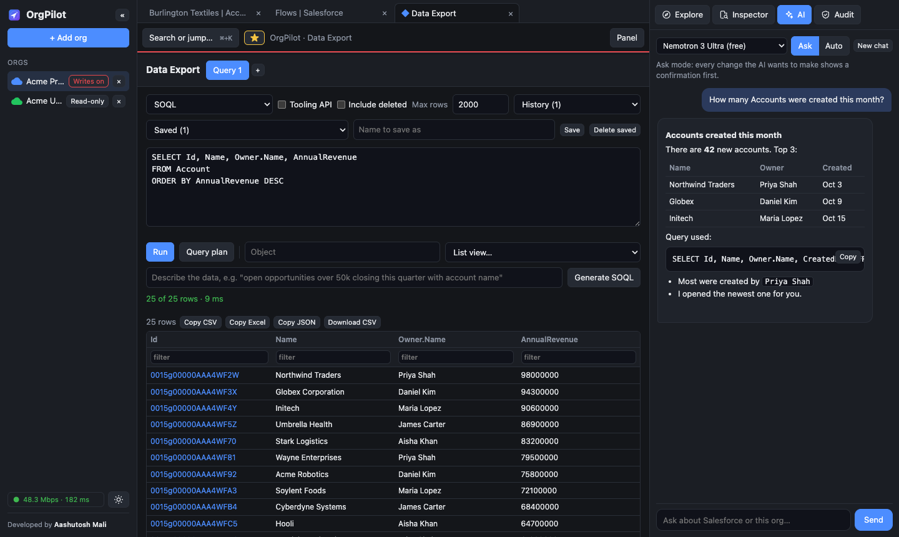

# OrgPilot

### All your Salesforce orgs. One cockpit.

A free desktop app for Salesforce admins and developers. Work in production and every sandbox side by side, with data, metadata and debugging tools built in, plus an AI co-pilot that asks before it changes anything.

**[Download](#download) · [Features](#features) · [Security](#security) · [FAQ](#faq) · [Support](#support)**

 

---

## 😩 The problem

If you work on Salesforce, your day probably looks like this:

- A dozen browser tabs across production and several sandboxes, and you keep getting logged out of them.
- One extension for queries, another for data loads, Setup for debug logs, a separate tool for deployments.
- That moment of doubt before every change: *am I in the right org?*

## 💡 The solution

**OrgPilot puts every org and every tool you reach for into one window.** Log in once per org and stay logged in. Each org gets its own colour and its own tabs, so production never gets mixed up with a sandbox. Every change shows you exactly what will happen before it runs, and can be undone.

---

## ✨ What you can do

### 🗂️ Work in all your orgs at once
- Log in to as many orgs as you like (production, Developer Edition, sandboxes, My Domain), including orgs with multi-factor authentication.
- Each org keeps its own session, colour and tab bar. Opening a page that's already open just switches to it.
- Your tabs reopen when you start OrgPilot again. Pin the ones you always need, drag tabs to reorder them, and right-click a tab for more.
- **Side by side:** click **Split** to show a second page, from the same or another org, next to the current one. Perfect for comparing a sandbox with production.
- **Favorites:** click ☆ on any record, list, report, Setup page or tool. Your favorites from every org are one click away in Explore → Favorites and in Ctrl/Cmd + K.
- OrgPilot updates itself: when a new version is out you'll see a short note at the top.
- Tabs you haven't used for a while go to sleep to save memory, and wake up when you click them.
- Optional banner per org (for example "PRODUCTION: careful") so you always know where you are.

### 🔎 Jump anywhere instantly
Press **Ctrl/Cmd + K** and type. Go straight to any Setup page, object, flow, profile, permission set, Apex class, user, recent item, or search records across the org. Paste a record Id to open it.

### 📤 Data Export
Write SOQL with field autocomplete, or switch to SOSL or GraphQL. Keep several queries open in tabs, reuse your history and saved queries, turn any list view into a query, and check the query plan. Sort and filter results, then copy them to Excel or download a CSV.

### 📥 Data Import
Paste rows straight from Excel, or load a CSV or JSON file. OrgPilot recognises the object from the record Ids, matches columns to fields, and runs insert, update, upsert, delete or undelete in batches. You see a result for every row, can retry the ones that failed, and can undo the whole job.

### 🧾 Show All Data
See every field on a record with its label, API name and type. Edit values inline and save them in one go, pin the fields you care about, check how often each field is actually filled in, and get a plain-English explanation of formula fields.

### 🐞 Debug logs and live events
Read debug logs as a summary (limits used, queries, DML, errors, slowest code) or as raw text with filters. Turn on logging for yourself or any user with one click. Watch platform events and Change Data Capture messages as they arrive.

### 🧩 Metadata tools
- **Dependencies**: find where a class, field, flow or component is used before you change it.
- **Flow Scanner**: checks every active flow for common problems such as queries inside loops, missing fault paths and hard-coded Ids.
- **Retrieve & Deploy**: pick components, download them as a package, validate or deploy, even from one org to another.
- **Create Fields**: create one field or dozens at once, and grant access through permission sets.

### 🧪 Run Apex and tests
Run anonymous Apex and see your debug output straight away, then run test classes and check code coverage, per class and for the whole org.

### 🔀 Org Compare
Compare Apex, flows, fields, validation rules, permission sets and more between two orgs. See what's different, what's only in one org, and a line-by-line comparison. Then validate or deploy the changes from one org to the other.

### 🩺 Org Health Scan
One click checks unused licences, Salesforce's security Health Check, who can see or change all data, flow problems, old Workflow Rules and Process Builders, Apex test coverage, and storage and API limits, with links to fix each one.

### 🕵️ Setup Audit Trail
See who changed what in Setup and when, for one org or all your orgs together, with filters and export.

### 👥 Users and org details
Find any user, log in as them, reset their password, freeze or unfreeze them, and see their permission sets. View org details and limits at a glance. Call any Salesforce API from the REST Explorer.

### ✨ AI co-pilot
Ask questions about your org in plain English: *"How many leads were created this week?"*, *"Why is this flow failing?"*, *"Describe the Opportunity object."* The AI looks things up in your org before answering, can write SOQL for you, and only talks about Salesforce.

**One sign-in, every major model:** click **Sign in with OpenRouter** in Settings → AI and you can use ChatGPT, Claude, Gemini, DeepSeek, Llama and 400+ other models, with no API keys to copy. You start on a free model and can switch anytime; paid models are billed by OpenRouter. Prefer your own key (Groq, OpenAI, Anthropic) or a model on your own computer? That's under *Advanced*.

Just ask, and OrgPilot does it in your current org:

| You type | OrgPilot |
|---|---|
| *"Show open opportunities over 50k closing this quarter"* | Writes the SOQL, runs it and shows the results with the query |
| *"Scan my flows for problems"* | Runs the Flow Scanner and lists what to fix first |
| *"Why did the last Apex job fail?"* | Reads recent debug logs, finds the errors and explains them |
| *"Open the newest Account"* | Opens the record in a tab |
| *"Set the Industry of Acme to Energy"* | Shows old and new value and waits for your approval |

---

## 🔐 Built to be safe around production

| | |
|---|---|
| **Your computer only** | No OrgPilot account, no OrgPilot servers, no tracking. The app talks directly to Salesforce. |
| **Encrypted credentials** | Salesforce logins and AI keys are encrypted with your operating system's keychain. Your password is only ever typed into Salesforce's own login page. |
| **Approve every change** | Imports, deletes, deployments and AI edits show exactly what will change (old → new) before anything runs. Production is always flagged. |
| **Audit log and undo** | Every change is recorded with its real result. Undo restores old values, removes inserted records or brings deleted ones back. |
| **AI on a short leash** | The AI can't change an org until you allow it for that org. In **Ask** mode every change needs your confirmation; in **Auto** mode only sandboxes skip it. Production always asks. |

---

## ⬇️ Download

| Your computer | File |
|---|---|
| Mac with Apple Silicon (M1 and newer) | `OrgPilot-mac-arm64.dmg` |
| Mac with Intel processor | `OrgPilot-mac-x64.dmg` |
| Windows 10 / 11 | `OrgPilot-windows-x64-setup.exe` (or the `.zip`, which needs no installation) |
| Linux | `OrgPilot-linux-x64.AppImage` or `.deb` for Debian/Ubuntu |

Get the latest version from the **[Releases page](https://github.com/aashutoshmali/orgpilot-downloads/releases/latest)** or the [OrgPilot website](https://orgpilot.aashutosh-smali.workers.dev).

**First launch:** OrgPilot isn't signed by Apple or Microsoft yet, so your computer may warn you once.
- **Mac:** open the app, then go to System Settings → Privacy & Security and click **Open Anyway**.
- **Windows:** if you see "Windows protected your PC", click **More info → Run anyway**.
- **Linux AppImage:** mark the file as executable, then open it.

## 🚀 Getting started

1. Open OrgPilot and click **+ Add org**.
2. Choose Production or Sandbox, type your username, and log in on the Salesforce page that appears. Click **Allow**.
3. Your org appears in the sidebar and opens its home page. Add as many orgs as you like.
4. Press **Ctrl/Cmd + K** to jump anywhere, or open the **Explore** panel on the right for all the tools.
5. Optional: open the **AI** panel and click **Sign in with OpenRouter** to switch on the AI co-pilot (free models available).

---

## ❓ Questions

**Is OrgPilot free?**
Yes. Donations are welcome but optional and don't unlock anything.

**Does my Salesforce data go to OrgPilot's servers?**
No. There are no OrgPilot servers. Your data travels only between your computer and Salesforce, and, if you use the AI features, the AI provider you chose.

**Can the AI change my org without asking?**
Not by default. AI changes are blocked until you allow writes for that org, and even then every change asks for confirmation unless you choose Auto mode in a sandbox.

**Is OrgPilot made by Salesforce?**
No. OrgPilot is an independent product and is not affiliated with, endorsed or sponsored by Salesforce, Inc.

---

## ☕ Support the project

OrgPilot is free. If it saves you time, you can buy me a coffee. It helps keep new features and fixes coming. Thank you!

---

**OrgPilot** · Developed by **[Aashutosh Mali](https://www.linkedin.com/in/aashutoshmali/)** · [LinkedIn](https://www.linkedin.com/in/aashutoshmali/) · [Email](mailto:aashutosh.smali@gmail.com)

© 2026 OrgPilot · [Privacy Policy](https://orgpilot.aashutosh-smali.workers.dev/privacy) · [Terms of Use](https://orgpilot.aashutosh-smali.workers.dev/terms) · [Third-party notices](THIRD_PARTY_NOTICES.md)

Salesforce is a trademark of Salesforce, Inc. OrgPilot is not affiliated with Salesforce, Inc.

